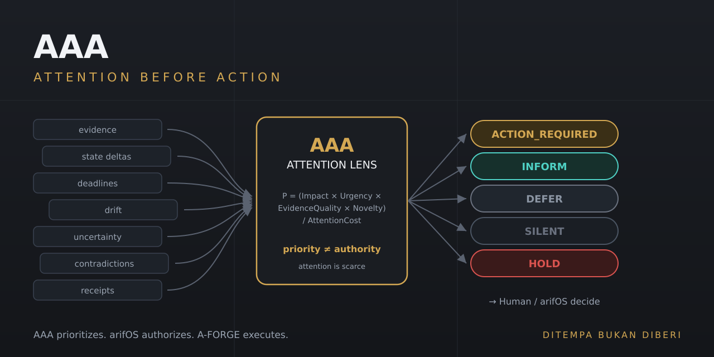

<!-- SOT-MANIFEST
federation_release: v2026.10.19 (state capture + housekeeping checkpoint)
last_verified: 2026-10-19T15:26:00Z
apex_zen: HERMES claims → CHRON temporal → AAA attention → arifOS authority → A-FORGE execution

identity:
  AAA : (evidence, state, deadlines, drift, uncertainty) → AttentionPacket
  irreducible_question: "What deserves scarce attention now?"

pipeline: Reality → HERMES → CHRON → AAA → arifOS/Human

public_ingress:
  MCP authority ingress:    arifOS :8088 (governed requests)
  A2A federation discovery: AAA    :3001 (inter-agent)

attention_formula:
  P = (Impact × Urgency × EvidenceQuality × Novelty) / AttentionCost
  EvidenceQuality = (1 - Uncertainty)   # source + freshness + reproducibility + independent support ONLY
  ActionRisk = f(Impact, Reversibility, BlastRadius)   # separate gate — NEVER folded into P

hard_overrides:
  - authority_violation: P = ∞
  - security_breach:    P = ∞
  - deadline_expiry:    P = ∞
  - failed_invariant:   P = ∞
  - action_risk_gate: Reversibility-blocked actions are surfaced to Arif regardless of P ranking (F13 2026-09-25: risk ≠ evidence quality)

organs_in_federation:
  arifOS:    authority plane     (irreducible: "May this action happen?")
  A-FORGE:  execution plane     (irreducible: "How do I execute the authorized action?")
  HERMES:   meaning plane       (irreducible: "What exactly is being claimed?")
  CHRON:    temporal plane      (irreducible: "When does this matter, and what did we expect?")
  FRAME:    independent witness (irreducible: "What actually happened?")
  VAULT999: immutable ledger    (irreducible: "Can we prove the chain later?")
  AAA:      attention plane     (irreducible: "What deserves scarce attention now?")
  arifFlow: metabolism/telemetry (FQ / receipts)

useful_agency_equation:
  UsefulAgency = Intelligence × Attention × Authority × TemporalDiscipline × MeaningIntegrity
  If any → 0, then AgencyQuality → 0.

counts_are_live:
  README numbers are release snapshots; live counts come from the federation registry.
  README_state = projection(registry_state)
-->

<p align="center">
  
</p>

# AAA

### Attention before action.

> Invariant: Routing a message ≠ authorizing its consequence. Attention is measured before action; authority is checked before mutation.

AAA is the **attention and agent-discovery plane** of the arifOS federation. It converts evidence, state, deadlines, drift and uncertainty into machine-readable **AttentionPackets** so humans and AI agents can identify what deserves attention — without confusing priority with authority.

> **What deserves scarce attention now?**
>
> **AAA prioritizes. arifOS authorizes. A-FORGE executes.**

AAA never judges, approves or mutates. Its authority ceiling is `DISPLAY_ONLY`.

[Live Agent Card](https://aaa.arif-fazil.com/.well-known/agent-card.json) · [A2A Endpoint](#agent-discovery) · [Quick Start](#30-second-proof) · [Protocol Conformance](#protocol-conformance-a2a-v10) · [Current Verified State](#current-verified-state) · [Security](./SECURITY.md)

[](./PROTOCOL_CONFORMANCE.md)
[](https://aaa.arif-fazil.com/.well-known/agent-card.json)
[](https://github.com/ariffazil/AAA/actions/workflows/agentic-ci.yml)
[](https://github.com/ariffazil/AAA/actions/workflows/governance-gate.yml)
[](./SECURITY.md)
[](./LICENSE)

---

## Choose your path

- **AI agent:** [discover skills and delegate through A2A](#agent-discovery)
- **Developer:** [run the gateway locally](#30-second-proof)
- **Human operator:** [inspect what currently needs attention](#what-aaa-does)
- **Auditor:** [inspect protocol and governance evidence](#protocol-conformance-a2a-v10)
- **Federation organ:** [publish state for reconciliation](#architecture)

---

## What AAA does

```text
AAA : (evidence, state, deadlines, drift, uncertainty) → AttentionPacket
```

Every UI and every agent projects from one machine-readable object. AAA does not create more intelligence; it decides what intelligence deserves attention. It consumes HERMES (meaning) and CHRON (temporal context) and never duplicates them.

### The priority formula

```
P = (Impact × Urgency × EvidenceQuality × Novelty) / AttentionCost
```

`EvidenceQuality = (1 − Uncertainty)` — source, freshness, reproducibility and independent support **only**. Reversibility is NOT evidence quality: it lives in a separate **ActionRisk** gate ([why](./docs/history/ATTENTION_PLANE_CORRECTIONS.md)), so a strongly-evidenced irreversible action still routes to Arif.

**Hard overrides (P = ∞, must-show):**

| Override | Reason |
|---|---|
| `authority_violation` | Constitutional boundary breached |
| `security_breach` | Integrity compromised |
| `deadline_expiry` | Temporal urgency hit zero |
| `failed_invariant` | Canon-0 violation |
| `action_risk_gate` | Reversibility-blocked action — surfaced to Arif regardless of P |

**Attention classes (5):** `ACTION_REQUIRED` ≥ 0.85 · `INFORM` ≥ 0.5 · `DEFER` ≥ 0.2 · `SILENT` < 0.2 · `HOLD` (override-driven)

The system can say **"Don't show Arif this now."** That is its most valuable capability.

---

## Agent discovery

```text
Agent Card:   https://aaa.arif-fazil.com/.well-known/agent-card.json
A2A endpoint: https://aaa.arif-fazil.com/a2a   (JSON-RPC · A2A-Version: 1.0)
```

**AAA is for:** capability discovery · skill inspection · bounded task delegation · inter-agent state exchange.

**AAA is NOT for:** constitutional judgment · MCP tool execution · system mutation · human authorization.

| Need | Use |
|---|---|
| Discover agents or delegate tasks | `https://aaa.arif-fazil.com/a2a` |
| Discover AAA capabilities | [`/.well-known/agent-card.json`](https://aaa.arif-fazil.com/.well-known/agent-card.json) |
| Call governed tools | `https://mcp.arif-fazil.com/mcp` (arifOS) |
| Inspect authority decisions | arifOS evidence surfaces |
| Execute an authorized action | A-FORGE — never AAA |

Live methods on the gateway: `agent/getCard` · `agent/listSkills` · `tasks/send` · `tasks/get` · `tasks/cancel` (probe: 2026-10-16).

---

## 30-second proof

```bash
git clone https://github.com/ariffazil/AAA.git
cd AAA
docker compose up -d

# AAA answers
curl -s http://localhost:3001/health

# the agent card is a real artifact
curl -s https://aaa.arif-fazil.com/.well-known/agent-card.json | jq .name
# → "AAA A2A Gateway"

# ask the gateway what it can do (JSON-RPC, A2A v1.0)
curl -s -X POST http://localhost:3001/a2a/ \
  -H 'content-type: application/json' -H 'A2A-Version: 1.0' \
  -d '{"jsonrpc":"2.0","id":1,"method":"agent/listSkills","params":{}}' | jq '.result.skills | length'
# → 8   (published skills, measured 2026-10-16)
```

Generate a sample AttentionPacket locally: `python3 scripts/attention_plane.py`.

---

## One AttentionPacket

The canonical packet carries 16+ fields ([full shape](./docs/README-FULL.md#canonical-attentionpacket)). The public minimal shape:

```json
{
  "subject": "Production schema drift",
  "attention_class": "ACTION_REQUIRED",
  "priority": 0.91,
  "why_now": "Observed drift affects the live contract",
  "uncertainty": 0.20,
  "recommended_organ": "arifOS",
  "required_authority": "HUMAN_REVIEW",
  "execution_required": false,
  "evidence_basis": ["probe:contract-schema", "witness:deployment-state"]
}
```

One subject → one packet. Every UI projects from this object.

### What happens after AAA raises attention?

1. AAA produces an AttentionPacket.
2. A human or arifOS inspects the evidence.
3. arifOS decides whether authority exists.
4. A-FORGE executes only an authorized action.
5. FRAME and VAULT999 preserve what actually happened.

**AAA never turns priority into permission. Priority is not authority.**

---

## AAA vs arifOS vs A-FORGE

| | AAA | arifOS | A-FORGE |
|---|---|---|---|
| Question owned | What deserves attention? | May this happen? | How is it executed safely? |
| Authority | **NONE** (`DISPLAY_ONLY`) | judgment (`JUDGE_ONLY`) | bounded mutation |
| Output | AttentionPacket | verdict + receipt | executed action + receipt |
| Failure mode | wrong priority (recoverable) | constitutional breach (`HOLD_888`) | unauthorised mutation |

GEOX / WEALTH / WELL produce domain evidence. FRAME independently witnesses. VAULT999 preserves the record. arifFlow metabolizes receipts. Each organ answers one question it owns; no organ cosplays as another. Full role table: [Architecture](#architecture).

---

## Current verified state

**Observed at: 2026-10-16T08:55Z** (live probes from this host)

| Check | Result |
|---|---|
| AAA service `:3001` | **UP, DEGRADED** — `deployment_drift: true` (deployed `c0d1469` ≠ source `e5bec19`) |
| Agent Card | reachable — `agent/getCard` answers |
| A2A `agent/listSkills` | pass — **8 published skills** (measured) |
| `getAuthenticatedExtendedCard` | **not served** on the live gateway |
| Signed envelope support | **unverified** |
| External witness | `witness_oracle: active` (federation geometry: 57 subjects, 72 ledger events) |
| Authority ceiling | `DISPLAY_ONLY` · **Mutation capability: NONE** |
| Apex scalars (self-report) | G 0.583 DEGRADED · C_dark 0.306 ELEVATED · W3 0.879 CONSENSUS |

Dynamic state is generated by probe. **If this section conflicts with the live endpoint, the endpoint wins.** Whole-federation observations (historical): [`docs/evidence/FEDERATION_PROBE_2026-09-27.md`](./docs/evidence/FEDERATION_PROBE_2026-09-27.md).

---

## Architecture

```
                ┌──────────────────────────────────────────┐
                │              Sovereign                   │
                └──────────────────┬───────────────────────┘
                                   │
                ┌──────────────────▼───────────────────────┐
                │              AAA :3001                   │
                │   classification + prioritization         │
                │   + recommendation — NO dispatch          │
                └──────┬─────────────────────────┬─────────┘
                       │                         │
              observes │                         │ recommends
                       ▼                         ▼
            ┌────────────────────┐     ┌─────────────────────┐
            │  HERMES :18087     │     │  CHRON :18102       │
            │  meaning            │     │  temporal            │
            └─────────┬──────────┘     └──────────┬──────────┘
                      └──────────┬───────────────┘
                                 ▼
                       AttentionPacket(s)   (one per subject)
                                 │
                                 ▼
                       arifOS :8088   (governed dispatch)
```

AAA does NOT touch A-FORGE, FRAME, VAULT999 or arifFlow directly. It produces AttentionPackets that arifOS / Human consume.

**Federation — one role table:**

| Organ | Plane | Irreducible question | Does NOT |
|---|---|---|---|
| **HERMES** | Meaning | "What exactly is being claimed?" | judge, execute |
| **CHRON** | Temporal | "When does this matter, and what did we expect?" | judge, execute |
| **AAA** | Attention | "What deserves scarce attention now?" | judge, execute, dispatch |
| **arifOS** | Authority | "What authority exists to act?" | execute, witness |
| **A-FORGE** | Execution | "How do I execute the authorized action?" | adjudicate, witness |
| **FRAME** | Witness | "What actually happened?" | judge, execute |
| **VAULT999** | Ledger | "Can we prove the chain later?" | judge, execute |

Supporting planes: **arifFlow** metabolism/FQ/receipts · **WEALTH** capital consequence intelligence · **GEOX** earth intelligence · **WELL** vitality mirror.

```
UsefulAgency = Intelligence × Attention × Authority × TemporalDiscipline × MeaningIntegrity
```

If any factor → 0, agency quality → 0. Federation design must hold all five non-zero. AAA owns the scarce-attention term.

---

## Protocol conformance (A2A v1.0)

| Required element | Status | Where |
|---|---|---|
| Agent card at `/.well-known/agent-card.json` | ✅ | [`public/.well-known/`](./public/.well-known/) · [live](https://aaa.arif-fazil.com/.well-known/agent-card.json) |
| Required card fields | ✅ | `.well-known/agent-card.json` |
| JSON-RPC transport at `/a2a/` with `A2A-Version: 1.0` | ✅ | [a2a/](./a2a/) |
| Protocol binding declaration | ✅ | `protocolBinding: JSONRPC` (A2A itself supports JSON-RPC, gRPC, HTTP+JSON) |
| Authenticated extended card | **live surface differs** | `agent/getAuthenticatedExtendedCard` is not served (probe 2026-09-27, re-confirmed 2026-10-16) |
| Agent metadata card | ✅ | `.well-known/agent.json` |
| Protocol conformance evidence | ✅ | [`PROTOCOL_CONFORMANCE.md`](./PROTOCOL_CONFORMANCE.md) |

---

## Known limits

- **Branch protection is not enabled** on `main` (no required PRs, no force-push block). For any public collaboration this matters more than badges: protect `main`, require PRs and selected checks, block force pushes and deletion. *(GitHub settings action — repository owner.)*
- `getAuthenticatedExtendedCard` is not served; signed envelope support is unverified.
- `.well-known/agent-card.json` and `.well-known/agent.json` are **byte-identical** in this repository (one card, two names). A generated index pointing at the canonical card is planned; historical cards under `agent-cards/` (`_audit/`, `.archive-*`) are archive, not active surface.
- No external benchmark or independent evaluation is published.
- Historical correction trail moved to [`docs/history/ATTENTION_PLANE_CORRECTIONS.md`](./docs/history/ATTENTION_PLANE_CORRECTIONS.md).

### Repository map

```text
Public product surfaces:   a2a/ · public/.well-known/ · agent-cards/agents|organs|extensions|schemas/
                           docs/ · PROTOCOL_CONFORMANCE.md · SECURITY.md
Internal operational       _archive/ · skills-archive/ · skills-cold/ · audit-scratch/
history (not product):     forge_work/ · agent-cards/_audit/ · .archive-* · .backup-* · .quarantine*
```

---

## Development

```bash
git clone https://github.com/ariffazil/AAA.git
cd AAA
docker compose up -d          # gateway on :3001
curl -s http://localhost:3001/health
python3 scripts/attention_plane.py   # sample AttentionPacket
```

## Documentation

- [Full Technical README](docs/README-FULL.md) · [Federation Architecture](docs/FEDERATION.md) · [A2A Organ Registry](docs/A2A_ORGAN_REGISTRY.md)
- [Protocol Conformance](PROTOCOL_CONFORMANCE.md) · [Deployment Guide](DEPLOYMENT.md) · [Changelog](CHANGELOG.md)
- Evidence: [federation probe 2026-09-27](docs/evidence/FEDERATION_PROBE_2026-09-27.md) · [correction history](docs/history/ATTENTION_PLANE_CORRECTIONS.md)

## Security · Contributing · License

[SECURITY.md](./SECURITY.md) · [CONTRIBUTING.md](./CONTRIBUTING.md) · **AGPL-3.0** ([LICENSE](./LICENSE)).

---

**DITEMPA BUKAN DIBERI** — Forged, Not Given. Built by ARIF FAZ.

<!-- FEDERATION-STANDARD v2026-10-15 START :: 333-AGI audit :: source: organs.yaml + git + live probes -->
## 🔗 Federation Identity
| Field | Value |
|---|---|
| Organ | `aaa` · CORE · control_plane |
| Ports | 3001 |
| Unit | aaa-a2a.service |
| Authority ceiling | DISPLAY_ONLY |
| Public card | https://aaa.arif-fazil.com/.well-known/agent-card.json |
| Flow graph | [FEDERATION.md](./docs/FEDERATION.md) — peta semua organ + repo |
<!-- FEDERATION-STANDARD v2026-10-15 END -->
