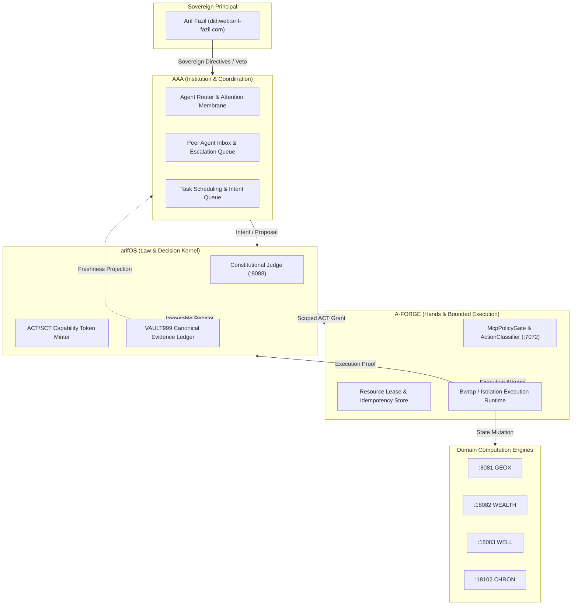

# ARCHITECTURE-DECISION.md — Next Horizon Federation Architecture
**Status:** Ratified Recommendation · **Owner:** AAA / arifOS / A-FORGE Architecture Group
**Target Date:** 2026-10-25 MYT · **Document ID:** `ADR-2026-10-25-NEXT-HORIZON`

---

## 1. Architectural Alternatives Evaluation

We evaluate three potential architectural paths against the live codebase:

| Dimension | Alternative A: Minimal Repair of Existing Sprawl | Alternative B: Consolidate Ownership into Three Repositories (Selected) | Alternative C: Introduce Heavy Durable Workflow Engine (e.g. Temporal/Kafka) |
|---|---|---|---|
| **Failure Isolation** | Poor. 57 heterogeneous MCP servers create cascading disconnects. | **High.** Clear boundary separation between Coordinator (AAA), Judge (arifOS), and Hands (A-FORGE). | High, but introduces distributed coordinator failure modes. |
| **Enforceable Authority** | Weak. Inconsistent point-of-mutation checks across ad-hoc scripts. | **Strict.** Authority enforced at kernel (:8088) and re-validated at execution (:7072). | Strict within engine, but bypassable at external adapter boundaries. |
| **Recovery Semantics** | Ad-hoc manual restarts; prone to duplicate execution on crashes. | **Deterministic.** Idempotency keys + independent state reconciliation before retry. | Fully automated replay, but requires stateful cluster persistence. |
| **Maintainability** | Low. Sprawling configs across `.kimi-code`, `.1mcprc`, `.copilot`. | **High.** Unified contract definitions; single source of truth per domain. | Low. Substantial operational overhead to manage workflow daemons. |
| **Latency** | Variable (15s timeouts on uncoordinated subprocess calls). | **Low & Bounded.** Direct local HTTP/IPC with lightweight JSON-RPC and leases. | Higher latency (50-100ms per step state persistence overhead). |
| **Monetary Cost** | Zero direct infra cost, but wasted compute on duplicate runs. | **Zero direct cost.** Leverages existing Linux host resources efficiently. | High. Additional cloud compute or daemon RAM/Disk footprint. |
| **Operational Effort** | High. Constant firefighting of dead ports and stale URIs. | **Low.** Clear lifecycle: test $\rightarrow$ patch $\rightarrow$ verify $\rightarrow$ deploy. | Very High. New orchestration substrate to configure, backup, and patch. |
| **Arif's Attention** | **Heavy Burden.** Human acts as manual router and message bus. | **Preserved.** Peer agent coordination via report lanes; escalate only true blocks. | Moderate to High during migration and cluster maintenance. |

### Architectural Verdict
**Selected: Alternative B (Consolidated Ownership into Three Repositories).**
Alternative A fails because entropy continues to compound. Alternative C is rejected as violating *ANTI-BANGANG LAW 3 & 8* (overengineering a heavyweight orchestrator when Linux filesystem semantics, atomic writes, and lightweight idempotency stores solve the proven failure class).

---

## 2. The Canonical Repositories & State Ownership

Three repositories represent three constitutional roles, not physical process colocation:



### Single Canonical Writer Table
Every persistent state object in the federation must have exactly ONE canonical writer:

| State Object | Canonical Writer | Location / Storage | Read-Only Consumers |
|---|---|---|---|
| **Constitutional Verdicts & Seals** | `arifOS Kernel` (:8088) | `/root/VAULT999/` | All agents, Cockpit, AAA |
| **Capability Grants (ACT/SCT)** | `arifOS Kernel` (:8088) | In-memory token signature (`Ed25519` / HMAC) | A-FORGE, Gateway |
| **Task Intent & Coordination Queue** | `AAA Coordinator` | `/var/lib/arifos/reports/`, AAA state | Worker agents |
| **Execution Leases & Idempotency** | `A-FORGE` (:7072) | In-memory / ephemeral `/tmp/aforge-leases` | Execution workers |
| **Subsurface Models & Logs** | `GEOX Engine` (:8081) | `/root/GEOX/data/` | Subsurface agents |
| **Financial Ledgers & Portfolios** | `WEALTH Engine` (:18082) | `/root/WEALTH/data/` | Wealth agents |
| **Human Wellness Signals** | `WELL Engine` (:18083) | `/root/WELL/data/` | Human Membrane |
| **Bitemporal Predictions & Calibration**| `CHRON Engine` (:18102) | `/root/chron/data/` | Reasoning agents |

---

## 3. Versioned Lifecycle Contracts

### 3.1 TaskIntent Contract (`v1.0.0`)
```json
{
  "$schema": "https://arif-fazil.com/schemas/contracts/task-intent-v1.json",
  "task_id": "task-7fd974cb776a",
  "idempotency_key": "idemp-20261025-001",
  "actor_id": "kimi-code/FI-008",
  "sovereign_intent": "Update actionClassifier to fail closed on unknown tools",
  "target_resource": "A-FORGE/src/domain/governance/actionClassifier.ts",
  "action_class": "EXECUTE_REVERSIBLE",
  "timeout_seconds": 120,
  "created_at": "2026-10-25T05:30:00Z"
}
```

### 3.2 Proposal Contract (`v1.0.0`)
```json
{
  "$schema": "https://arif-fazil.com/schemas/contracts/proposal-v1.json",
  "proposal_id": "prop-4a88bc91",
  "task_id": "task-7fd974cb776a",
  "proposer_actor_id": "agent-coordinator-333",
  "operation": "FILE_WRITE",
  "target": "src/domain/governance/actionClassifier.ts",
  "arguments": {
    "patch": "export const MUTATE_FLOOR = 'EXECUTE_REVERSIBLE';"
  },
  "arguments_digest": "sha256:7a59c3d42e01...",
  "proposed_at": "2026-10-25T05:30:05Z"
}
```

### 3.3 Authorization Contract (`ACT_v1.0.0`)
```json
{
  "$schema": "https://arif-fazil.com/schemas/contracts/authorization-grant-v1.json",
  "grant_id": "grant-91e3d006f34d",
  "task_id": "task-7fd974cb776a",
  "subject_actor_id": "agent-executor-lane-a",
  "target_resource": "src/domain/governance/actionClassifier.ts",
  "operation": "FILE_WRITE",
  "arguments_digest": "sha256:7a59c3d42e01...",
  "policy_revision": "v2026.10-ratified",
  "replay_nonce": "nonce-e4b9-4c81-8729",
  "issued_at": 1792905406,
  "expires_at": 1792905706,
  "revoked": false,
  "issuer_signature": "sha256:kernel-sig-anchor..."
}
```

### 3.4 ExecutionAttempt Contract (`v1.0.0`)
```json
{
  "$schema": "https://arif-fazil.com/schemas/contracts/execution-attempt-v1.json",
  "attempt_id": "att-15497ea0f517",
  "task_id": "task-7fd974cb776a",
  "grant_id": "grant-91e3d006f34d",
  "worker_id": "worker-lane-a",
  "status": "COMPLETED",
  "error_code": null,
  "execution_metrics": {
    "wall_ms": 142,
    "exit_code": 0,
    "bytes_mutated": 240
  },
  "attempted_at": "2026-10-25T05:30:10Z"
}
```

### 3.5 Observation / Verification Contract (`v1.0.0`)
```json
{
  "$schema": "https://arif-fazil.com/schemas/contracts/verification-v1.json",
  "verification_id": "ver-8b22a07c",
  "task_id": "task-7fd974cb776a",
  "verifier_identity": "deterministic-disk-verifier",
  "passed": true,
  "observed_state_hash": "sha256:9c02d184...",
  "expected_state_hash": "sha256:9c02d184...",
  "details": "Target file exists and hash exactly matches expected patch",
  "verified_at": "2026-10-25T05:30:12Z"
}
```

### 3.6 Execution Receipt Contract (`v1.0.0`)
```json
{
  "$schema": "https://arif-fazil.com/schemas/contracts/receipt-v1.json",
  "receipt_id": "rcpt-0d9533a7efca",
  "task_id": "task-7fd974cb776a",
  "auth_grant_id": "grant-91e3d006f34d",
  "execution_attempt_id": "att-15497ea0f517",
  "verification_id": "ver-8b22a07c",
  "payload_digest": "sha256:3e2a09...",
  "sealed_at": 1792905412.0,
  "receipt_signature": "sha256:VAULT999:rcpt-0d9533a7efca:3e2a09..."
}
```

---

## 4. Pre-Execution Authorization vs. Post-Execution Evidence Sealing

A critical architectural distinction restored in this horizon:

1. **Pre-Execution Authorization (`ACT_MINT` / `GRANT_AUTHORITY`):**
   - Issued *before* any side effect.
   - Binds the subject, scope, exact argument digest, target file/endpoint, and expiration.
   - Must be re-validated at the exact point of mutation by the executor (`A-FORGE`).
   - If invalid, expired, or tampered, the executor aborts with `HOLD` or `REJECTED`.

2. **Post-Execution Evidence Sealing (`SEAL_RECEIPT` / `VAULT999_APPEND`):**
   - Minted *after* mutation has occurred and an independent effect verifier has confirmed the physical state change on disk or wire.
   - Neither the author nor the executor may self-seal (Gödel separation: author $\neq$ verifier $\neq$ judge).
   - Existence of a receipt alone never proves effect; the independent effect verification ID is cryptographically anchored inside the receipt payload.

---

## 5. Rollback and Migration Discipline

- **Backward Compatibility:** All new contracts provide read-only projection adapters for legacy tools (`fastmcp` tools continue to function without wire changes).
- **Phased Rollout:**
  - Phase 1: Deploy test harness and validation logic without mutating live traffic.
  - Phase 2: Canary test on isolated file mutations in disposable worktrees.
  - Phase 3: Enforce mode-aware contract gates on production MCP servers after kernel reload.
- **Rollback Trigger:** If any production tool reports `NO_CONTRACT` on legitimate read requests or if p95 latency exceeds 1500ms, fall back immediately to prior commit by restarting systemd units from their pinned `.service` binaries.
