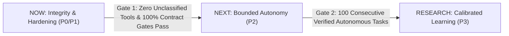

# NEXT-HORIZON-BLUEPRINT.md — Staged Execution Roadmap
**Horizon Window:** Q4 2026 – Q1 2027 · **Guiding Directive:** REALITY > EVERYTHING
**Architecture Baseline:** ADR-2026-10-25-NEXT-HORIZON

---

## Stage Overview & Progression Gates

---

## 1. NOW: Integrity & Immediate Repairs (Weeks 1–2)

### 1.1 Authority & Action Classification Hardening (P0)
- **Objective:** Eliminate all silent escalation paths where mutating operations hide under `OBSERVE`.
- **Owner:** `A-FORGE` (Hands) + `arifOS` (Kernel).
- **Deliverables:**
  1. Commit and deploy `actionClassifier.ts` fail-closed contract (`MUTATE_FLOOR = "EXECUTE_REVERSIBLE"`).
  2. Complete mode-aware resolution for the 8 suspect tools (`forge_telegram`, `forge_drive_create`, `forge_seal_run`, `forge_dispatch_lane`, `forge_compile_task`, `forge_collect_evidence`, `forge_chain_state`, `auth_pipeline`).
  3. Deploy `mode_contracts.json` updates in `arifOS` for `arif_report.report` and `arif_report.flush`.
- **Acceptance Criteria:**
  - Build test `test/actionClassifier.test.ts` passes 343/343 tests.
  - Calling an unregistered tool name returns `EXECUTE_REVERSIBLE` and triggers `McpPolicyGate` `HOLD`.
  - Wire call `arif_report.report` escalates to `MUTATE` class.
- **Rollback:** `git checkout HEAD~1 -- src/domain/governance/actionClassifier.ts`.

### 1.2 Protocol & Schema Conformance (P1)
- **Objective:** Fix verified broken schema fields in domain services and remove dead advertised links.
- **Owner:** Domain Organs (`WEALTH`, `WELL`, `AAA`).
- **Deliverables:**
  1. Patch `WEALTH/server_federated.py` to emit `tool_name: "capital_health"` and `domain: "wealth"` in the root of structured response payloads.
  2. Prune 60 dead resource URIs (`chron://state`, etc.) from `/root/AAA/mcp/federation_gateway.py`.
  3. Install request concurrency throttle / worker queue on `WELL/server.py` to prevent event-loop dropouts under burst load.
- **Acceptance Criteria:**
  - `capital_health` response validates against official `outputSchema` with 0 Pydantic errors.
  - `federation-gateway` `resources/read` returns 200 OK or 0 broken URIs.
  - WELL sustains 50 sequential tool/resource calls without stream disconnection.

### 1.3 Epistemic Metric Grounding (P1)
- **Objective:** Eliminate fabricated heuristics for $\Delta S$ and publish honest confidence intervals for CHRON.
- **Owner:** `CHRON` + `arifOS` Analysis Group.
- **Deliverables:**
  1. Retain literal `0` or `null` for unmeasured $\Delta S$ in `federation-manifest.json` and deprecate synthetic mocks in scripts.
  2. Update CHRON reporting dashboard to display:
     - Strict Decisive Accuracy: $81.1\%$ ($30/37$)
     - Raw Accuracy: $73.2\%$ ($30/41$)
     - Effective Blended Accuracy: $79.5\%$ with explicit footnote of partial credit on 4 mixed outcomes
     - 95% Wilson Confidence Interval: $[0.581, 0.843]$
     - Brier Score: $0.1735$
- **Acceptance Criteria:** Zero occurrences of hardcoded formulaic $\Delta S$ in active production scripts.

---

## 2. NEXT: Reliable Bounded Autonomy (Weeks 3–6)

### 2.1 Peer Agent Communication via Report Lane (P2)
- **Objective:** Take Arif out of the inter-agent message loop.
- **Owner:** `AAA` (Coordinator) + `arifOS` (Report Lane).
- **Deliverables:**
  1. Route all background agent notifications through `/var/lib/arifos/reports/inbox.jsonl`.
  2. Configure peer consumption cursors so agents self-coordinate across work boundaries.
  3. Strict filter on human Telegram outbox: ONLY items classified `decision` or `blocked` trigger outbound messages to Arif.
- **Acceptance Criteria:**
  - Zero "FYI" or status progress spam reaches human Telegram.
  - 100% of inter-agent tasks exchange state via `arif_report` peer inbox.

### 2.2 Point-of-Mutation Execution Leases & Crash Recovery (P2)
- **Objective:** Prevent duplicate side effects during network timeouts or agent crashes.
- **Owner:** `A-FORGE` (Execution Runtime).
- **Deliverables:**
  1. Integrated lease manager in `A-FORGE` with target-level locking and TTL.
  2. Idempotency key requirement on all mutating tool invocations.
  3. Crash recovery hook: before retrying a timed-out mutation, independently verify whether the external effect already occurred.
- **Acceptance Criteria:**
  - Passing `test_04_crash_after_side_effect_recoverable` in production harness.
  - Zero double-booking or duplicated file writes across concurrent runs.

---

## 3. RESEARCH: Evidence-Gated Learning (Weeks 7–12)

### 3.1 Deterministic Task Verifiers before Reinforcement Learning (P3)
- **Objective:** Enable policy self-improvement (GRPO/RL) safely without reward hacking.
- **Owner:** Research & Calibration Group.
- **Preconditions (Hard Gates):**
  - Reliable deterministic verifiers implemented for 100% of target benchmark tasks.
  - Held-out evaluation suite established to detect over-optimization.
  - Anti-reward-hacking invariant: Verifier code and tests reside in read-only / immutable storage unreachable by the learning agent.
- **Acceptance Criteria:** Demonstrated task completion increase on held-out tasks without degradation in constraint adherence.

### 3.2 Dynamic Context Retrieval with Provenance & Expiry (P3)
- **Objective:** Replace monolithic prompt dumps with scoped, expiring, bitemporal retrieval.
- **Owner:** `CHRON` + `Qdrant` / Memory Substrate.
- **Deliverables:**
  1. All retrieved memories must carry `valid_time` and `known_at` timestamps.
  2. Stale or contradicted memories automatically yield to newer attested evidence.
- **Acceptance Criteria:** Verification that superseded facts are never injected into active agent reasoning contexts.
